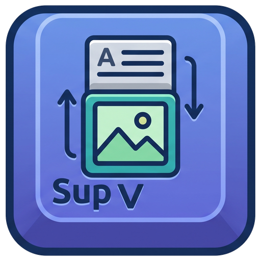
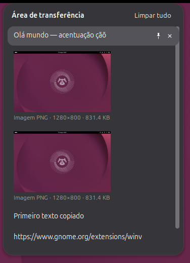
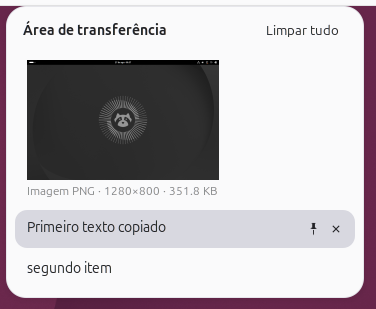
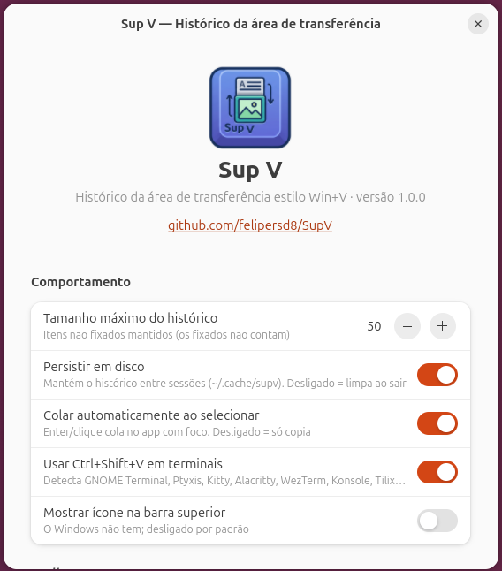

<p align="center">
  
</p>

<h1 align="center">Sup V</h1>

<p align="center">
  Histórico da área de transferência estilo <b>Win+V</b>, dentro do GNOME Shell.<br>
  <code>Super+V</code> abre · <code>Enter</code> cola no app com foco · fixe, filtre, imagens com miniatura.
</p>

<p align="center">
  <a href="https://github.com/felipersd8/SupV/releases/latest"></a>
  
  
  <a href="LICENSE"></a>
</p>

---

O Windows tem o `Win+V`: um painel com tudo que você copiou, que cola direto onde você está
digitando. No GNOME as alternativas (CopyQ, Diodon, GPaste…) são aplicativos separados, com
janela própria, foco próprio e sensação de "corpo estranho". O **Sup V** é uma extensão do
GNOME Shell — o histórico faz parte do próprio shell, exatamente como no Windows.

<p align="center">
  
  &nbsp;&nbsp;
  
</p>

## Recursos

- **`Super+V`** abre o painel perto do mouse, com o item mais recente já selecionado.
  `Esc`, clicar fora ou `Super+V` de novo fecham.
- **`Enter` ou clique cola imediatamente** no aplicativo que tinha o foco — e o foco continua
  no mesmo campo de texto. Em terminais usa `Ctrl+Shift+V` automaticamente.
- **Texto e imagens** (print screen, "copiar imagem" do navegador…) com miniatura.
- **Fixar** itens: ficam no topo, sobrevivem ao "Limpar tudo" e ao logout.
- **Sem duplicatas**: copiar algo que já está na lista só o traz para o topo.
- **Filtro** por digitação, navegação completa por teclado.
- **Persistência** entre sessões (opcional), gravação atômica e sem escrever a cada `Ctrl+C`.
- Ignora gerenciadores de senha (KeePassXC, Bitwarden…) e a seleção com o mouse (PRIMARY).
- Segue o tema do shell (claro/escuro), sem cores fixas. Sem ícone na barra por padrão
  (o Windows também não tem) — pode ligar nas preferências.
- Funciona em **Wayland e X11**, sem `xdotool`/`ydotool`: usa o dispositivo de entrada
  virtual do próprio Mutter.

## Instalação

Baixe na página de releases: **https://github.com/felipersd8/SupV/releases/latest**

| Arquivo | Para quem |
|---|---|
| `supv_<versão>_all.deb` | Ubuntu / Debian / derivados (recomendado) |
| `supv@felipersd8.github.io.shell-extension.zip` | qualquer distro, instalação manual |
| `supv-<versão>.tar.gz` | código-fonte |

> **Wayland exige logout/login** para o GNOME Shell carregar uma extensão nova ou
> atualizada. No X11 basta `Alt+F2`, `r`, `Enter`. Instalando pelo `.deb` ou pelo
> `install.sh`, **o Sup V é ativado sozinho no primeiro login** (veja
> [Ativação automática](#ativação-automática)); pelo zip é preciso o `enable` manual.

### .deb

```bash
sudo apt install ./supv_1.0.1_all.deb
# logout/login (Wayland) ou Alt+F2 → r (X11) — o Sup V ativa sozinho no próximo login
```

Instala em `/usr/share/gnome-shell/extensions/supv@felipersd8.github.io/` e o schema em
`/usr/share/glib-2.0/schemas/`. Não há (ainda) repositório APT/PPA — `apt-get install supv`
não funciona; o `apt install ./arquivo.deb` resolve as dependências do mesmo jeito.

### Zip

```bash
gnome-extensions install --force supv@felipersd8.github.io.shell-extension.zip
# logout/login (Wayland) ou Alt+F2 → r (X11)
gnome-extensions enable supv@felipersd8.github.io
```

### A partir do código-fonte (sem root)

```bash
git clone https://github.com/felipersd8/SupV.git && cd SupV
./install.sh            # ou: make install
# logout/login (Wayland) ou Alt+F2 → r (X11) — ativa sozinho no próximo login
```

### Ativação automática

O GNOME Shell só descobre uma extensão nova ao iniciar a sessão, e não há API para
"habilitar na próxima sessão". Por isso o `.deb` instala `/etc/xdg/autostart/supv-autoenable.desktop`
(e o `install.sh`, `~/.config/autostart/…`): no primeiro login após a instalação ele executa
`gnome-extensions enable supv@felipersd8.github.io` e grava o marcador
`~/.config/supv/auto-enabled` para nunca mais repetir. Se você desativar a extensão depois,
ela **não** volta sozinha. Nada além disso é alterado na sua sessão; a entrada não aparece em
"Aplicativos de inicialização" (`NoDisplay=true`). Uma vez ativada, a extensão fica gravada em
`org.gnome.shell enabled-extensions` e permanece ativa em todos os logins.

### Snap

Não existe e não vai existir: extensões do GNOME Shell rodam **dentro do processo do shell**
e não podem ser confinadas — o formato snap não se aplica.

## Uso

| Ação | Como |
|---|---|
| Abrir / fechar o painel | `Super+V` (configurável) · `Esc` · clique fora |
| Colar o item selecionado | `Enter` ou clique |
| Só copiar, sem colar | `Shift+Enter` ou clique com o botão do meio |
| Navegar | `↑` `↓` `Home` `End` `PageUp` `PageDown` (`Tab` / `Shift+Tab` também) |
| Fixar / desafixar | `Ctrl+P` ou o alfinete do card (aparece ao passar o mouse) |
| Excluir item | `Delete` ou o `×` do card |
| Limpar tudo (mantém fixados) | `Ctrl+Shift+Delete` ou o botão **Limpar tudo** |
| Filtrar | digite qualquer texto · `Backspace` apaga · `Ctrl+Backspace` limpa |

Limites padrão: 50 itens não fixados, 1 MB por texto, 10 MB por imagem — tudo ajustável.

### Preferências

`gnome-extensions prefs supv@felipersd8.github.io` (ou pelo app **Extensões**).

<p align="center"></p>

- Tamanho máximo do histórico · Persistir em disco · Colar automaticamente ao selecionar ·
  `Ctrl+Shift+V` em terminais · Ícone na barra superior · Atalho · Limpar histórico agora
- Avançado: atraso antes de colar (ms), limites de tamanho de texto e imagem

### Onde fica o histórico

`~/.cache/supv/history.json` (textos e metadados) e `~/.cache/supv/img/<sha256>.png`
(imagens). Com "Persistir em disco" desligado, nada fica em disco entre sessões.

## Super+V e as notificações do GNOME

O GNOME usa `Super+V` **e** `Super+M` para a lista de notificações
(`org.gnome.shell.keybindings toggle-message-tray`). Nem o instalador nem o pacote mexem nas
suas configurações. Quem faz isso é a extensão, **na primeira ativação**: guarda o valor
original, remove só o `Super+V` e deixa o `Super+M`. **As notificações continuam em
`Super+M`.** Ao desativar a extensão o valor original é restaurado. Detalhes em
[docs/ARQUITETURA.md](docs/ARQUITETURA.md#atalho-e-o-conflito-com-as-notificações).

## Desinstalação

```bash
gnome-extensions disable supv@felipersd8.github.io   # 1) restaura o Super+V das notificações

sudo apt remove supv          # 2a) instalação pelo .deb (ou: sudo apt purge supv)
./uninstall.sh                # 2b) install.sh / zip  (--purge apaga também ~/.cache/supv e as configurações)
# ou: gnome-extensions uninstall supv@felipersd8.github.io
```

Se removeu sem desativar antes e o `Super+V` das notificações não voltou:
`gsettings reset org.gnome.shell.keybindings toggle-message-tray`.

## Solução de problemas

| Sintoma | O que fazer |
|---|---|
| `Super+V` abre as notificações | a extensão não está ativa: `gnome-extensions info supv@felipersd8.github.io` — "não existe" = o shell ainda não recarregou (logout/login); "Habilitada: Não" = `gnome-extensions enable supv@felipersd8.github.io` |
| "A extensão … não existe" logo após instalar | o shell ainda não recarregou (Wayland: logout/login; X11: `Alt+F2` → `r`) |
| `Enter` não cola | aumente **Atraso antes de colar** nas preferências; alguns apps demoram a recuperar o foco. Em terminais confira a opção `Ctrl+Shift+V` |
| Colou no lugar errado | o painel devolve o foco à janela que o tinha antes de abrir; se você clicou em outra janela com o painel aberto, ele fecha sem colar |
| Ver erros | `journalctl --user -f -o cat -u 'org.gnome.Shell@*.service' \| grep -iE "supv\|JS ERROR"` ou `Alt+F2` → `lg` → aba *Extensions* |

Compatibilidade: GNOME Shell 46, 47, 48, 49 e 50 (`shell-version` no `metadata.json`).
Desenvolvido e testado no **Ubuntu 26.04 / GNOME 50.1 / Wayland**.

## Para desenvolvedores

```bash
make check     # schema + sintaxe
make install   # instala no usuário
make test      # sessão headless do GNOME Shell + smoke test (~40 verificações), sem logout
make all       # zip + tarball + .deb em dist/
```

- [docs/ARQUITETURA.md](docs/ARQUITETURA.md) — módulos, fluxo de dados, decisões técnicas,
  chaves de configuração, diferenças entre versões do GNOME.
- [docs/DESENVOLVIMENTO.md](docs/DESENVOLVIMENTO.md) — sessão headless, ferramentas de
  teste, empacotamento, release.
- [CONTRIBUTING.md](CONTRIBUTING.md) — como reportar bugs e enviar PRs.
- [CHANGELOG.md](CHANGELOG.md).

## Licença

GPL-3.0-or-later — veja [LICENSE](LICENSE). © 2026 [felipersd8](https://github.com/felipersd8).
